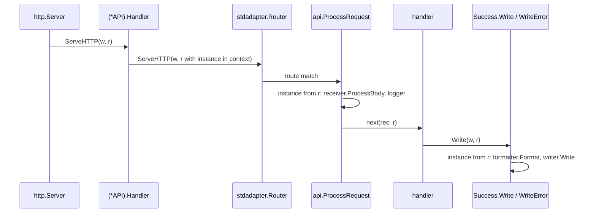

# ADR 0001: api v1, configuration per instance

- Status: Accepted (2026-11-21); implemented step by step through the v1 stories, all in v1.0.0:
  - 5.1 lands the instance, `Handler` and the two mode options (sections 2–3 for the modes; the `Get*Value*` helpers still use the default instance);
  - 5.2 the receiver, formatter and writer options; 5.3 codes as declared (section 4; landed, including a `ResponseFormatter` passed with `WithResponseFormatter`); 5.4 kind overrides and the error hook (section 7; landed); 5.5 the logger, redaction and an instance writer that never exits (section 6; landed); 5.6 problem details (section 8; landed).
- Issues: API-07 (#21), API-02 (#16), API-12 (#26), the v1 part of API-01 (#15).
- Related: ADR 0002 (stdadapter on ServeMux patterns, lands with story 5.7) will record the routing change planned for the same release (API-08).

## Context

`api` holds its configuration in package state: a package-level `core.API` (`api.go`) swapped through `RegisterNew*`, the modes in `modes.go` (`CurrentRequestMode`, `CurrentResponseMode`), formatter switches (`TraceVisibility`, `TraceIDLength`, `BlankSuccess`), logging (`Print`, `PrintError`, `Fatal`, `SensitiveLogKeys`, body-logging flags). Two binaries of one service drift apart in configuration, and tests interfere through package state (API-07). The v0 releases added options only per call, per route or on `*doc.Docs` and left four things for v1: the instance (API-07), codes as declared by default (API-02), RFC 9457 errors (API-12), and the kind-to-status override and error hook (API-01).

## Decision

### 1. Module path and version

- `v1.0.0` keeps the module path `github.com/jgolang/api`. Go requires a `/vN` suffix only from v2, so no import changes.
- v1 removes nothing. Every v0 exported name keeps compiling; the ones replaced by an instance option carry `// Deprecated: use api.New(api.WithX(...)) instead.` (the replacement ships in the same release).
- Removing a deprecated name later is a v2 (`github.com/jgolang/api/v2`).
- No intermediate tags while v1 is built; the owner tags `v1.0.0` once after the last change.

### 2. The instance

```go
// API holds one service's api configuration. It is immutable after New and
// safe for concurrent use.
type API struct { /* unexported */ }

// Option configures an API in New.
type Option func(*options) // options is unexported

func New(opts ...Option) *API

// Handler makes next answer with this instance: responses, WriteError,
// ProcessBody and the package middlewares called while serving a request
// use the instance's configuration.
func (a *API) Handler(next http.Handler) http.Handler
```

- An instance owns exactly: request mode, response mode, request receiver, response formatter, response writer, code case, logger, sensitive log keys, kind-to-status overrides, error hook. Internally it builds its own `core.API` with `core.New`; `core` does not change.
- The type is named `API` (it wraps `core.API`; `doc.API` stays the OpenAPI metadata).
- An instance has no setters. Options are applied once in `New`; there is nothing to drift after start-up. `Option` takes an unexported `options` struct that `New` owns, not the `*API`, so no `Option` value can change an instance after `New` returns.
- `New` returns `*API` without an error and never panics. An unknown mode value falls back to the default, as `SetRequestMode`/`SetResponseMode` do, and this is documented on the option.
- `New()` with no options behaves like v0's defaults (plain requests, envelope responses, the same formatter output, trace suffix 1, ID length 6, blank successes), except: codes as declared (section 4) and no logging (section 6).

Options (one exported function each):

| Option | Replaces (v0, now deprecated) | Default in `New` |
|---|---|---|
| `WithRequestMode(RequestMode)` | `SetRequestMode`, `CurrentRequestMode` | `RequestModePlain` |
| `WithResponseMode(ResponseMode)` | `SetResponseMode`, `CurrentResponseMode` | `ResponseModeEnvelope` |
| `WithRequestReceiver(core.APIRequestReceiver)` | `RegisterNewAPIRequestReceiver` | built-in receiver |
| `WithResponseFormatter(core.APIResponseFormatter)` | `RegisterNewAPIResponseFormatter` | built-in formatter |
| `WithResponseWriter(core.APIResponseWriter)` | `RegisterNewAPIResponseWriter` | built-in writer |
| `WithLowercaseCodes()` | (v0 behavior) | codes as declared |
| `WithKindStatus(codes.Kind, int)` | none (new, API-01) | `StatusForKind` |
| `WithErrorHook(func(r *http.Request, err error, status int))` | none (new, API-01) | none |
| `WithLogger(*slog.Logger)` | `Print`, `PrintError`, `Fatal` | no logging |
| `WithSensitiveLogKeys(keys ...string)` | `SensitiveLogKeys` | the v0 list |

The mode and code-case options apply to the built-in receiver and formatter: `RequestReceiver`, `RequestReceiverV2` and `ResponseFormatter` passed with `WithRequestReceiver`/`WithResponseFormatter` (as values or pointers) take the instance's modes, so the built-in components of an instance never read the package mode variables. A custom receiver or formatter owns its own behavior, as in v0; a type that embeds a built-in one is custom, and its promoted methods read the package mode variables and the package formatter settings, and lowercase codes. A nil interface value keeps the built-in; a typed nil pointer to a custom component is used as given. The security guarantor and param validator are not per instance: every instance forwards to the ones set with `RegisterNewAPISecurityGuarantor` and `RegisterParamValidator` (see "What stays package-level in v1").

### 3. How handlers, routes, docs and routers attach to an instance

- The instance travels in the request context. `a.Handler(next)` stores it; every package function that takes the `*http.Request` looks it up: `Success.Write`, `Error.Write`, `Warning.Write`, `Informative.Write`, `WriteError`, `ProcessBody`, `ProcessEncryptedBody`, `ProcessRequest`, `RequestBody`/`NewRequestBodyMiddleware`, the token middlewares, the `Get*Value*` helpers. Without an instance in the context they use the default instance (section 5). Handler code does not change; a service adds one line at start-up:

```go
a := api.New(api.WithResponseMode(api.ResponseModePlain))
docs := doc.New(doc.API{Title: "Tasks", Version: "1.0.0"})
router := stdadapter.New(http.NewServeMux(), docs)
api.Post(router, "/tasks", api.ProcessRequest(createTask), doc.Body(Task{}))
http.ListenAndServe(":8080", a.Handler(router))
```

- Route registration does not change: `api.Get/Post/Put/Patch/Delete(router, ...)` take the router as an argument and hold no state, so they are not deprecated.
- The doc registry stays on `*doc.Docs` (already an instance since v0.6.0). The `API` instance does not own a `*doc.Docs`; `doc` stays independent of the root package.
- Routers: adapters keep `RegisterAdapter`/`NewRouter` and `stdadapter.New(mux, docs)`. They need no instance: `a.Handler` wraps the router, or any sub-tree of it.
- Tests isolate by wrapping: `a.Handler(http.HandlerFunc(h)).ServeHTTP(rec, req)`. Two instances in one test binary do not see each other's options.
- Cost: one `context.Value` lookup per response write. Response writing is a hot path, so the change that introduces the lookup runs `BenchmarkSuccessWrite` before and after.



### 4. Codes as declared (API-02)

- An instance from `New` sends `core.ResponseCode` exactly as declared (`PLN-001`). `WithLowercaseCodes()` restores v0's lowercasing.
- The default instance keeps lowercasing. A v0 program that upgrades without code changes sends the same codes; only programs that move to `api.New` see declared codes. The trace suffix uses the same code text as the `code` field.

### 5. The deprecated default instance

- The package keeps one unexported default instance. Unlike instances from `New`, it reads the deprecated package variables at call time (`CurrentRequestMode`, `CurrentResponseMode`, `TraceVisibility`, `TraceIDLength`, `BlankSuccess`, `Print`/`PrintError`/`Fatal`, `SensitiveLogKeys`, body-logging flags) and the implementations set with `RegisterNew*`. v0 code compiles and behaves as in v0.10.0 (except the routing change planned in ADR 0002 (stdadapter on ServeMux patterns, lands with story 5.7), which will apply to every program that uses `stdadapter`).
- `RegisterNew*`, `SetRequestMode`, `SetResponseMode` and the variables listed in the options table only affect the default instance; their doc comments say so and point at the option.
- `TraceVisibility`, `TraceIDLength`, `BlankSuccess`, `PrintFullEvent`, `LogRequestBody`, `LogResponseBody`, `MaxLoggedBodyBytes` get no instance option (no present need). Instances use the v0 defaults (1, 6, true, bodies not logged). They stay, not deprecated, documented as default-instance-only, because a deprecation needs a replacement in the same release.

### 6. Logger and redaction

- `WithLogger(*slog.Logger)` takes the standard `log/slog` logger, so `api` gains no dependency (`api` must not import `jgolang/log`). Request and response lines become `slog` records with the same fields (`event_id`, `method`, `uri`, `status`, `duration_ms`, headers).
- An instance without `WithLogger` writes no logs.
- An instance never calls `Fatal` and never exits: a response that cannot be encoded is logged at error level through the instance logger. The default instance keeps v0's `Fatal`.
- `WithSensitiveLogKeys(keys...)` adds keys to the default list; it cannot remove a default key (security defaults are not weakened).
- As landed in 5.5: `ProcessRequest` writes two info records, `request` (`event_id`, `method`, `uri`, `form` when parsed, `headers`) and `response` (`event_id`, `method`, `uri`, `status`, `status_text`, `duration_ms`). Errors met while serving a request (a rejected body in `ProcessRequest`/`RequestBody`, a failed `Get*Value*`/`UnmarshalBody` helper) are error records with an `error` attribute; a recovered panic is a `panic recovered` error record with the panic value and `event_id`, never a dump of the request. An instance's key list is the v0 list plus `cookie` and `session` (the default instance's `SensitiveLogKeys` is unchanged); added keys are lowercased and blank ones ignored; matching stays v0's case-insensitive substring match. Query strings in `uri` and the form values are masked by key with the literal `[REDACTED]`, keeping the other parameters' order and encoding. Bodies are never logged (no option, per section 5). The built-in writer of an instance encodes before writing: a body that cannot be encoded is logged as `response cannot be encoded` and answered with 500 and the instance formatter's `Error500()` body (bare 500 if that fails too); `http.ErrBodyNotAllowed` is not logged. `core.APIResponseWriter.Write` receives no request, so the writer's `response cannot be encoded`/`response cannot be written` records carry no request context or `event_id`. A custom writer, including a type that embeds `ResponseWriter`, is used as given and keeps v0 behavior (it can call `Fatal`). An instance never reads `Print`, `PrintError`, `Fatal` or `SensitiveLogKeys`, now deprecated.

### 7. Errors: kind-to-status override and error hook (API-01)

- `WriteError(w, r, err)` keeps its signature. With an instance it takes the status from the instance's overrides, else `StatusForKind`. `StatusForKind` stays the documented default mapping and is not deprecated.
- `WithKindStatus(kind, status)` overrides one kind; repeat it for more. A per-kind override instead of a whole mapping function, so a service cannot forget the default rows.
- `WithErrorHook(fn)` is called by `WriteError` after the status is decided and before the response is written, with the original error, so a service can log or count it without wrapping every handler. Only `WriteError` calls it (the other error helpers receive no `error` to report); a panic in the hook is not recovered (it is the caller's code).
- As landed in 5.4: an override status outside 400–599 is ignored (an error never answers 2xx/3xx, and `New` returns no error), and the empty kind cannot be overridden, so errors without a kind and nil errors always answer 500. A later valid override for the same kind wins; an ignored call leaves any earlier override in place. A later `WithErrorHook` replaces an earlier one, and nil means no hook. The response title follows the decided status: the internal title for any 5xx (like `Error501`), the unauthorized title for 401/403, the default title otherwise. The hook receives the status `WriteError` decided, which may differ from the one sent if the handler already wrote a header or a custom formatter or writer changes it. Only `WriteError` calls the hook: the library's own rejections (body-parse failures in `RequestBody`/`ProcessRequest`, the token middlewares' 401s, `ProcessRequest`'s panic 500) do not. The hook is shared by all requests and must be safe for concurrent use. A hook panic propagates out of `WriteError` with nothing written, reaching `ProcessRequest`'s recovery (a 500, logged with the panic value through the instance's `WithLogger` logger, and not logged without one) or `net/http`'s (the connection is aborted).

### 8. RFC 9457 problem details (API-12)

- New response mode value `ResponseModeProblem` (`"problem"`), accepted by `WithResponseMode` only. `SetResponseMode` keeps its v0 set, so the default instance never writes problem details.
- In this mode an `Error` response is written as `application/problem+json`:

```json
{"type": "about:blank", "title": "Error response!", "status": 404, "detail": "task not found", "code": "PLN-404", "event_id": "abc123"}
```

  `title` is the response title (e.g. `Error response!`, not the status phrase RFC 9457 section 4.2.1 suggests for `about:blank`), `status` the HTTP status, `detail` the public message without the trace suffix, and `code` and `event_id` are extension members (RFC 9457 section 3.2); empty members are omitted. `type` is always `about:blank` (no per-code URIs) and the trace suffix is not added, since `code` and `event_id` carry it. Content, token, actions and info are never put in the problem body.
- Success, warning and informative responses write their content as the body (as `ResponseModeNone`).
- Only the built-in formatter bound by `New` writes problem details; a custom formatter, or one embedding `ResponseFormatter` (which reads the package variable), never does. The problem formatter adds `Content-Type: application/problem+json` to a copy of `Headers` only when they do not set one, so a `Content-Type` set in `Headers` wins also for problem errors. The 500 sent when an instance's body cannot be encoded is the formatter's body, so it carries the formatter's `Content-Type` (`application/json`, or `application/problem+json` in problem mode), not one set in the failed response's `Headers`.
- The built-in `ResponseWriter` (default instance and instances) sets `Content-Type: application/json` only when the formatted headers do not set one. This is a behavior change for v0 callers who put a `Content-Type` in `Headers` (it was overwritten; now it is kept) and goes in the release notes.

## What stays package-level in v1

Not deprecated, shared by every instance, and listed as the narrowed `FUNC-04` deviation: name registries (`RegisterAdapter`/`NewRouter`, `RegisterAuth`, `RegisterCodec`, `RegisterCrypto`, `RegisterValidator`, `RegisterTraceProvider`, `doc.RegisterExporter`), `RegisterTraceIDProvider`, `GetRouteVar`, header key names (`SecurityTokenHeaderKey`, `EventIDHeaderKey`, `UserIDHeaderKey`), default titles and messages, `ResponseCodes`, `SkipPaths`, security credentials (`Username`, `Password`, `CustomTokenValidatorFunc`, `ValidateBasicAuthCredentialsFunc`), map methods (`AddNewMapMethod`, `ValidateMethods`), `RegisterParamValidator`, `RegisterNewAPISecurityGuarantor`, `Write(data, w)`, and the default-instance formatter and body-logging variables of section 5. A later assessment proposes a version plan for them.

## Stateless names that stay as they are

`Get/Post/Put/Patch/Delete`, `StatusForKind`, `WriteError`, `QueryString/Int/Bool/Enum`, `WithQueryCode`, response constructors (`Success200`, `Error400`, …), every `doc` option (`Summary`, `Public`, `Security`, `QueryEnum`, `PathEnum`, `ResponseExamples`, …) and `*doc.Docs` methods (`SetDefaultSecurity`, `AddSecurityScheme`).

## Consequences

- Two binaries of one service configure their own instance; tests stop sharing state.
- One extra context lookup per response.
- Instances read no package variables for what they own; the `FUNC-04` deviation shrinks to the shared list above instead of disappearing.
- Programs that stay on the package-level API see no wire change in v1 except the routing change planned in ADR 0002 (stdadapter on ServeMux patterns, lands with story 5.7) (and section 8's `Content-Type` note).
- v1 doubles some surface (option + deprecated name) until a v2 removes the deprecated names.

## Alternatives considered

- **Explicit writes** (`a.Write(w, r, resp)`, `a.WriteError(w, r, err)`) instead of the context: every handler and every package middleware would change, or need instance twins.
- **`/v2` module path:** not needed; v0 → v1 keeps the path.
- **Instance owns `*doc.Docs` and routes (`a.Get(...)`):** duplicates the router helpers and couples the root package to the doc registry; the context needs none of it.
- **Whole mapping function for kinds** (`WithStatusForKind(func(codes.Kind) int)`): more flexible, but every override must remember to fall back to `StatusForKind`.
- **Default instance switches to declared codes:** a wire change for every v0 program on upgrade with no way back short of migrating, since no new global setter is allowed.
